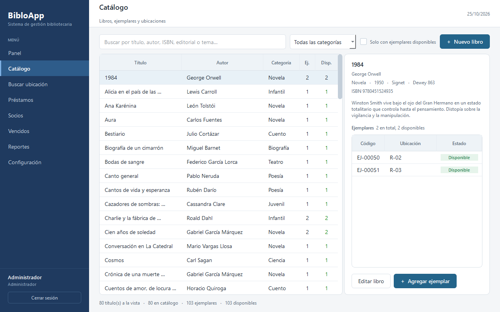
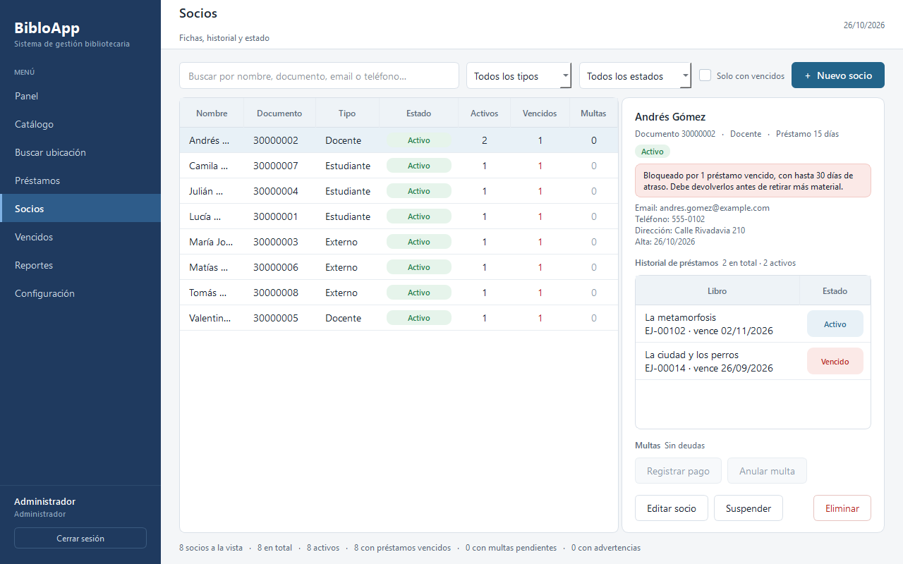
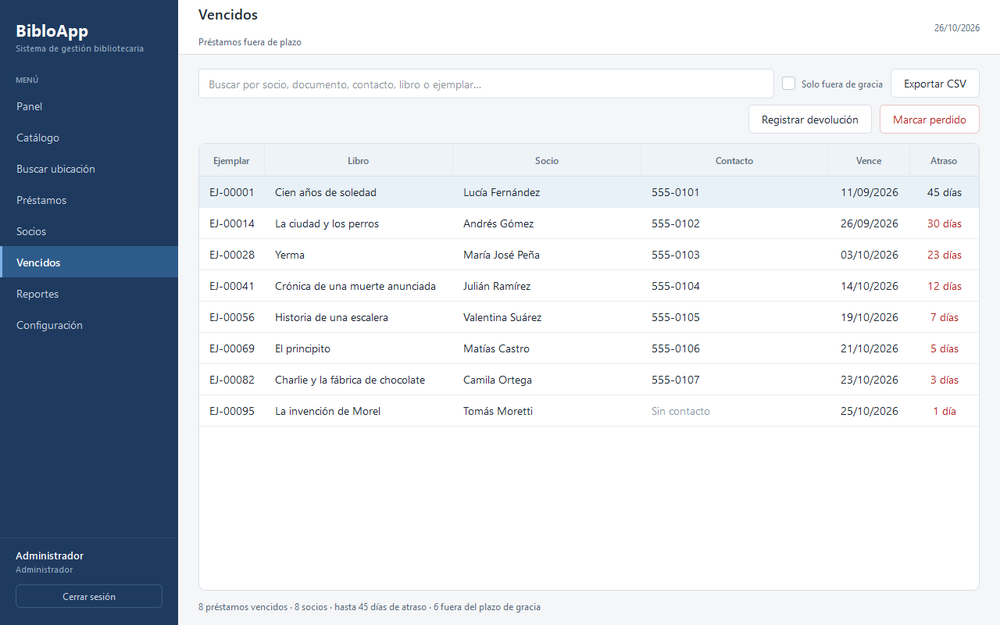

# BibloApp

Aplicación de escritorio para la gestión de una biblioteca pequeña: catálogo,
ejemplares, socios, préstamos, vencidos, multas y ubicación física de cada
libro.

- **Interfaz:** Python + PySide6 (Qt 6)
- **Base de datos:** SQLite, en un solo archivo local
- **Plataforma:** Windows 10/11
- **Idioma:** español


## Funcionalidades

- **Catálogo:** libros, ejemplares, ISBN, categorías, búsqueda por título, autor o
  tema y control de disponibilidad.
- **Socios:** fichas con datos de contacto, historial de préstamos, situación
  actual, multas y advertencias.
- **Préstamos:** altas, devoluciones, renovaciones, pérdidas y recuperaciones,
  con plazos distintos según el tipo de socio.
- **Vencidos:** listado de préstamos fuera de plazo, filtro por días de gracia y
  exportación a CSV para enviar recordatorios.
- **Multas:** deudas por pérdida, registro de pagos y anulaciones.
- **Ubicación física:** cada ejemplar registra sala, estantería y balda.
- **Usuarios y permisos:** roles de administrador, bibliotecario y auxiliar.
- **Auditoría y respaldos:** registro de movimientos y copias de seguridad de la
  base local.

## Capturas

| Catálogo | Socios | Vencidos |
|---|---|---|
|  |  |  |

## Requisitos

- Windows 10 u 11
- Python 3.12 o superior (probado con Python 3.14)

## Instalación

```bat
git clone https://github.com/AltairCGS/BibloApp.git
cd BibloApp
python -m venv .venv
.venv\Scripts\python.exe -m pip install -r requirements.txt
```

## Ejecución

Doble clic en `run.bat`, o desde la consola:

```bat
.venv\Scripts\python.exe -m app.main
```

En el primer arranque se crea `data/biblioteca.db` con las ubicaciones, los
usuarios y un catálogo mínimo de demostración.

## Cuentas iniciales

| Usuario | Contraseña | Rol |
|---|---|---|
| `admin` | `admin123` | Administrador |
| `bibliotecario` | `biblio123` | Bibliotecario |
| `auxiliar` | `aux123` | Auxiliar |

> Cambiar estas contraseñas antes de usar la aplicación con datos reales.

## Demo de Vencidos

La carpeta `demo/` permite probar la pantalla de Vencidos y la exportación CSV
sin tocar la base principal.

Doble clic en `demo/abrir_vencidos_demo.bat` y entrar con `admin` / `admin123`.
La demo incluye 8 préstamos vencidos con atrasos de 1 a 45 días y 8 socios de
ficción.

Para regenerarla:

```bat
.venv\Scripts\python.exe demo\crear_demo_vencidos.py
```

Los detalles están en [`demo/LEEME.md`](demo/LEEME.md).

## Catálogo de ejemplo

El archivo [`datos/catalogo_ejemplo.json`](datos/catalogo_ejemplo.json) contiene
80 libros y 103 ejemplares listos para importar. No incluye datos de socios.

```bat
.venv\Scripts\python.exe -m app.db.importar datos/catalogo_ejemplo.json --reemplazar
```

La opción `--reemplazar` borra el catálogo actual y se niega a continuar si hay
préstamos registrados. El importador también acepta una clave opcional
`socios`, útil para cargar una base de prueba propia.

## Pruebas

El proyecto incluye **209 pruebas automatizadas** sobre servicios, base de datos
e importador. Usan una base SQLite temporal y nunca modifican
`data/biblioteca.db`.

```bat
.venv\Scripts\python.exe -m pip install -r requirements-dev.txt
.venv\Scripts\python.exe -m pytest
```

También se pueden ejecutar con doble clic en `run_pruebas.bat`. El detalle de la
cobertura está en [`docs/PRUEBAS.md`](docs/PRUEBAS.md).

## Estructura

```
app/
  config.py          constantes, rutas y reglas de negocio
  security.py        hash PBKDF2 de contraseñas
  main.py            arranque y control de sesión
  db/
    models.py        tablas (Libro, Ejemplar, Socio, Prestamo, ...)
    database.py      conexión SQLite, sesiones y respaldos
    seed.py          datos iniciales
    importar.py      importador de catálogos en JSON
  services/
    auth.py          autenticación y auditoría
    catalogo.py      libros, ejemplares y ubicaciones
    socios.py        fichas, historial y situación de préstamo
    prestamos.py     salidas, devoluciones, renovaciones y pérdidas
    vencidos.py      préstamos fuera de plazo y recordatorios
    multas.py        deudas, pagos y anulaciones
    reglas.py        plazos y límites configurables
    permisos.py      verificación de permisos
    panel.py         consultas del panel principal
  ui/
    theme.py         paleta y hoja de estilos QSS
    widgets/         componentes reutilizables
    views/           pantallas (login, panel y módulos)
data/                base de datos local (no se versiona)
datos/               catálogo de ejemplo
demo/                base y lanzador de la demo de Vencidos
docs/                diseño, pruebas y capturas
tests/               pruebas automatizadas con pytest
```

## Datos y privacidad

- La base real `data/biblioteca.db`, los respaldos y los CSV exportados están
  excluidos por `.gitignore`.
- La demo se genera localmente a partir de datos ficticios; no se versiona.
- Las capturas usan un catálogo de ejemplo y socios de ficción con correos
  `example.com`.
- El repositorio no incluye listados de socios ni información personal.

## Documentación

- [`docs/DISENO.md`](docs/DISENO.md): guía de interfaz y personalización visual.
- [`docs/PRUEBAS.md`](docs/PRUEBAS.md): qué cubre cada grupo de pruebas.
- [`demo/LEEME.md`](demo/LEEME.md): uso y regeneración de la demo.

## Estado del proyecto

**Fase 1 completa:** panel, catálogo, socios, préstamos, vencidos y multas.

**Próximos pasos:**

- Buscar ubicación por sala, estantería y balda (Fase 2).
- Etiquetas QR, escáner y plano de la biblioteca (Fase 2).
- Reportes, configuración, auditoría visible e inventario físico (Fase 3).
